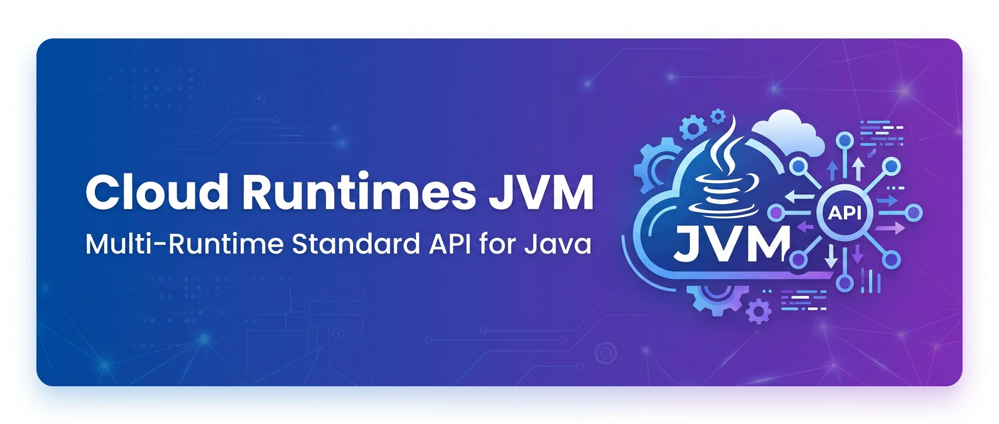
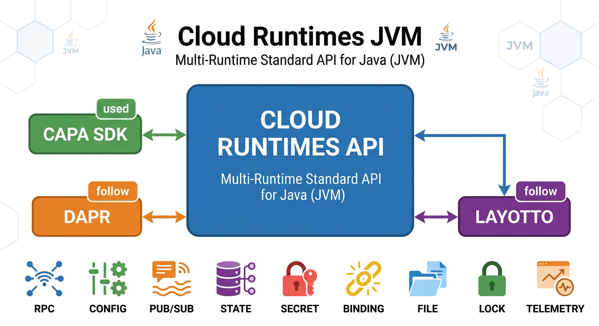
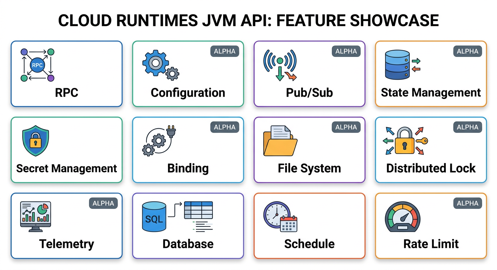

<p align="center">
  
</p>

<h1 align="center">Cloud Runtimes JVM</h1>

<p align="center">
  <strong>Multi-Runtime Standard API for the JVM</strong>
</p>

<p align="center">
  <a href="https://github.com/capa-cloud/capa"><strong>Capa</strong></a> ·
  <a href="https://dapr.io/"><strong>Dapr</strong></a> ·
  <a href="https://github.com/mosn/layotto"><strong>Layotto</strong></a>
</p>

---

## 📖 Introduction

**Cloud Runtimes JVM** provides the **Multi-Runtime Standard API** for Mecha architecture projects on the Java Virtual Machine (JVM).

This project defines a unified, vendor-neutral API specification that enables Java applications to use standardized interfaces for distributed system capabilities across different runtime implementations.

### Supported Runtimes

| Runtime | Status | Description |
|---------|--------|-------------|
| [Capa](https://github.com/capa-cloud/capa) | ✅ Used | Primary Mecha SDK implementation |
| [Dapr](https://dapr.io/) | 📋 Follow | Sidecar runtime reference |
| [Layotto](https://github.com/mosn/layotto) | 📋 Follow | MOSN-based sidecar implementation |

---

## 🏗️ Architecture

<p align="center">
  
</p>

### Module Structure

```
cloud-runtimes-jvm/
├── cloud-runtimes-api          # Core API definitions
├── cloud-runtimes-capa         # Capa SDK implementation
├── cloud-runtimes-dapr         # Dapr runtime adapter
├── cloud-runtimes-layotto      # Layotto runtime adapter
└── pom.xml                     # Maven parent POM
```

**Key Design Principles:**
- **API-First**: Clean separation between API specification and implementation
- **Runtime Agnostic**: Works with Capa SDK, Dapr, Layotto, and future runtimes
- **Vendor Neutral**: No lock-in to specific cloud providers or platforms

---

## ✨ Features

<p align="center">
  
</p>

### Stable Features

| Feature | Description | Status |
|---------|-------------|--------|
| 🔗 **Service Invocation** | RPC service-to-service communication | ✅ Stable |
| ⚙️ **Configuration** | Dynamic configuration management | ✅ Stable |
| 📨 **Pub/Sub** | Publish/Subscribe messaging | ✅ Stable |
| 💾 **State Management** | Key-value state storage | ✅ Stable |
| 🔐 **Secret Management** | Secure secret retrieval | ✅ Stable |
| 🔌 **Binding** | External system integration | ✅ Stable |
| 📁 **File System** | File storage operations | ✅ Stable |
| 🔒 **Distributed Lock** | Distributed locking | ✅ Stable |
| 📊 **Telemetry** | Logs, metrics, and traces | ✅ Stable |

### Alpha Features

| Feature | Description | Status |
|---------|-------------|--------|
| 🗄️ **Database** | SQL database operations | 🔬 Alpha |
| ⏰ **Schedule** | Scheduled task management | 🔬 Alpha |
| ⚡ **Rate Limit** | Rate limiting controls | 🔬 Alpha |
| 🌍 **Environment** | Environment variable management | 🔬 Alpha |
| 🔴 **Native Redis** | Direct Redis operations | 🔬 Alpha |
| 📝 **Native SQL** | Direct SQL operations | 🔬 Alpha |
| 📦 **Native S3** | Direct S3 operations | 🔬 Alpha |

---

## 🎯 Motivation

Cloud Runtimes JVM was created to address the need for **standardized, portable APIs** in the Multi-Runtime ecosystem:

- **[Future plans for Dapr API](https://github.com/dapr/dapr/issues/2817)** - Community discussion on API standardization
- **[Make Java SDK independent](https://github.com/mosn/layotto/issues/188)** - Decoupling API from implementation
- **[Decompose core and enhanced APIs](https://github.com/dapr/dapr/issues/3600)** - API layering strategy
- **[Java SDK Design](https://github.com/mosn/layotto/issues/206)** - API design patterns

---

## 🚀 Getting Started

### Maven

Add the dependency to your `pom.xml`:

```xml
<dependency>
    <groupId>group.rxcloud</groupId>
    <artifactId>cloud-runtimes-api</artifactId>
    <version>1.19.RELEASE</version>
</dependency>
```

### Gradle

Add the dependency to your `build.gradle`:

```groovy
implementation 'group.rxcloud:cloud-runtimes-api:1.19.RELEASE'
```

### Runtime Implementations

Choose your runtime implementation:

```xml
<!-- For Capa SDK -->
<dependency>
    <groupId>group.rxcloud</groupId>
    <artifactId>cloud-runtimes-capa</artifactId>
    <version>1.19.RELEASE</version>
</dependency>

<!-- For Dapr -->
<dependency>
    <groupId>group.rxcloud</groupId>
    <artifactId>cloud-runtimes-dapr</artifactId>
    <version>1.19.RELEASE</version>
</dependency>

<!-- For Layotto -->
<dependency>
    <groupId>group.rxcloud</groupId>
    <artifactId>cloud-runtimes-layotto</artifactId>
    <version>1.19.RELEASE</version>
</dependency>
```

---

## 🌐 Ecosystem

Cloud Runtimes JVM is part of the broader Capa Cloud ecosystem:

- **[capa-java](https://github.com/capa-cloud/capa-java)** - Java SDK implementation
- **[cloud-runtimes-python](https://github.com/capa-cloud/cloud-runtimes-python)** - Python API specification
- **[cloud-runtimes-golang](https://github.com/capa-cloud/cloud-runtimes-golang)** - Go API specification

---

## 🤝 Contributing

We welcome contributions! Please see our [Contributing Guide](CONTRIBUTING.md) for details.

1. Fork the repository
2. Create a feature branch (`git checkout -b feature/amazing-feature`)
3. Commit your changes (`git commit -m 'Add amazing feature'`)
4. Push to the branch (`git push origin feature/amazing-feature`)
5. Open a Pull Request

---

## 📜 License

This project is licensed under the Apache License 2.0 - see the [LICENSE](LICENSE) file for details.

---

<p align="center">
  <strong>Building portable, vendor-neutral cloud APIs for Java</strong>
</p>

<p align="center">
  <a href="https://github.com/capa-cloud">Capa Cloud</a> ·
  <a href="https://capa.rxcloud.group/">Documentation</a>
</p>
